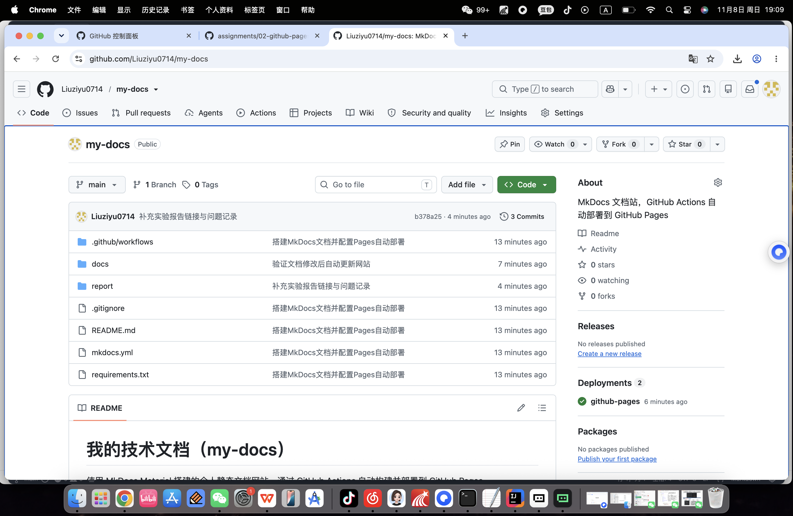
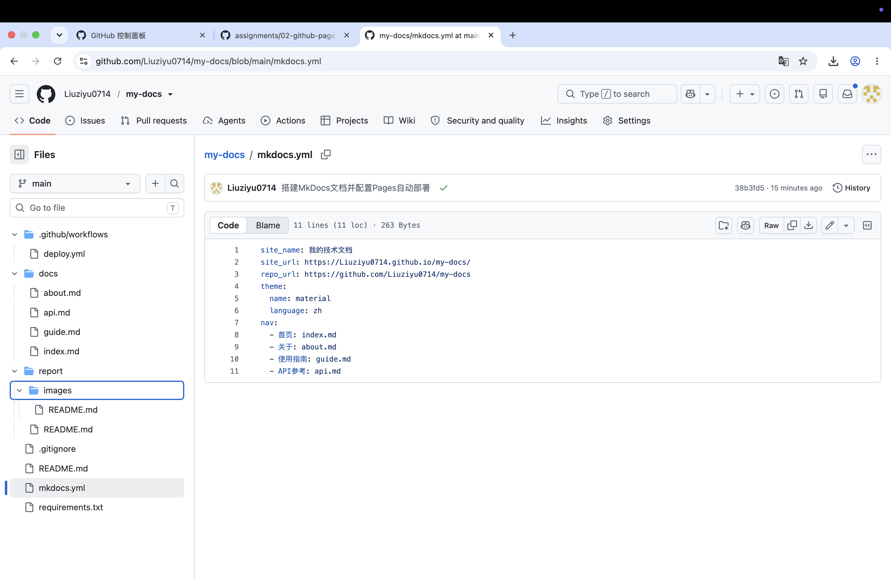
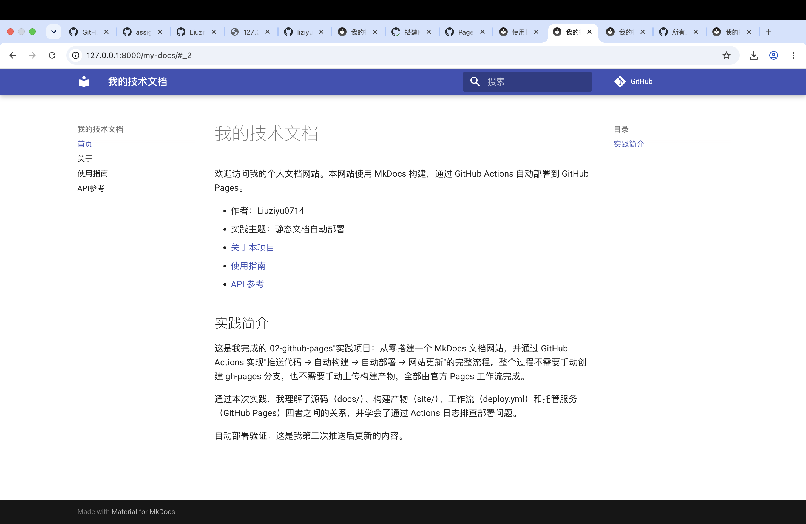
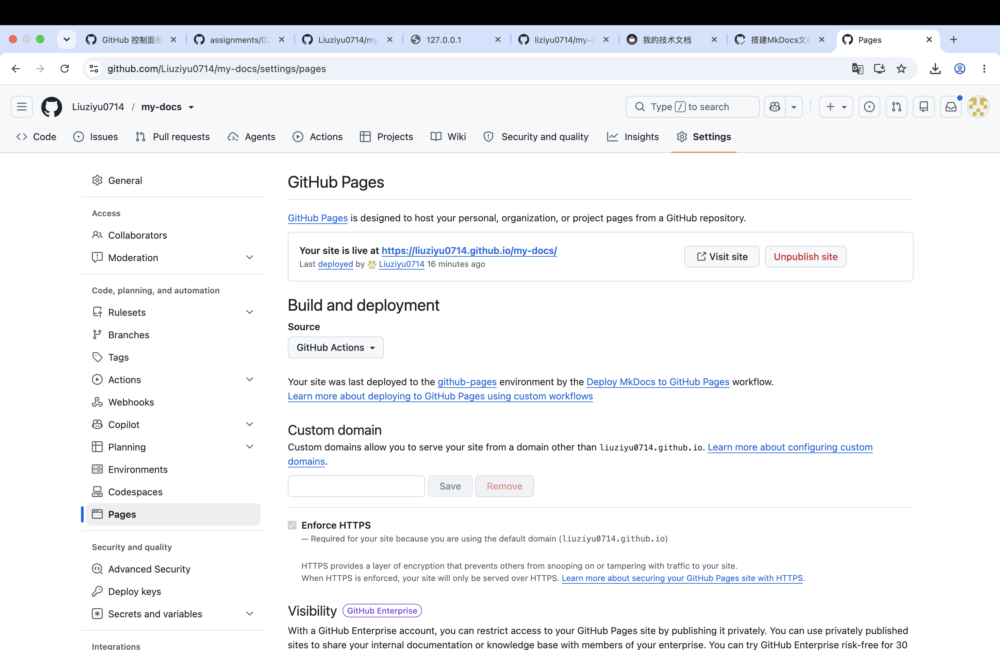
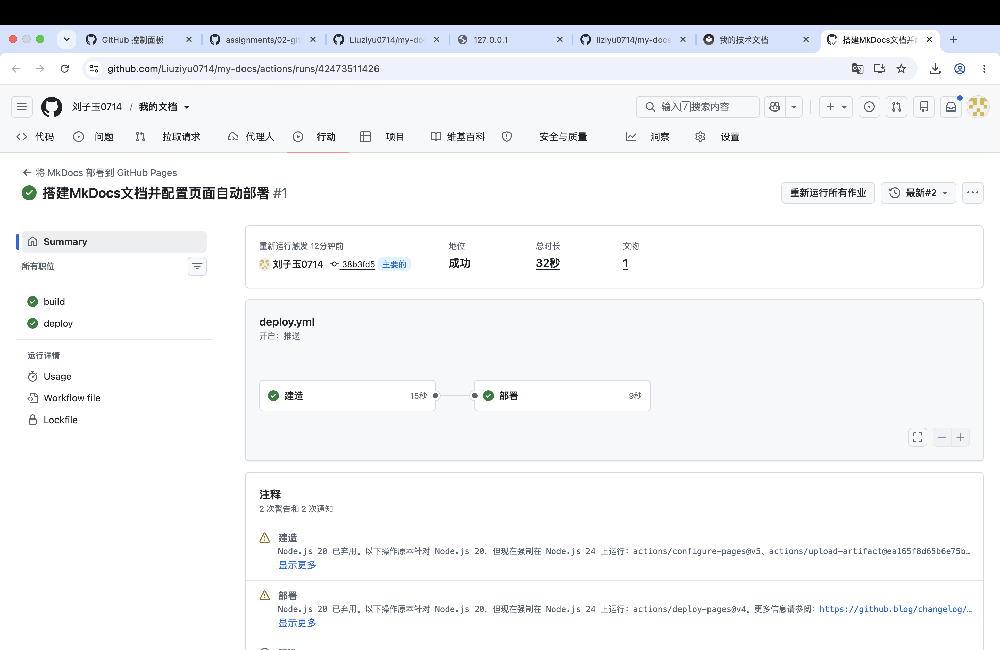
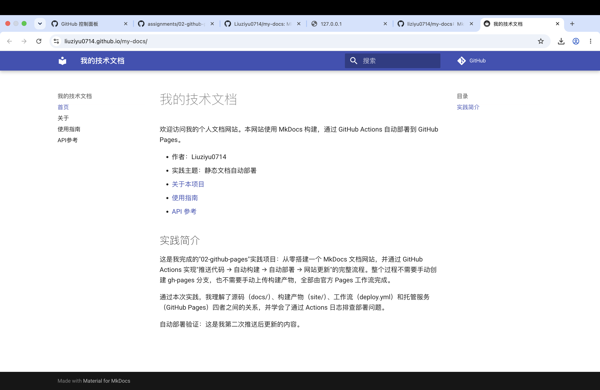
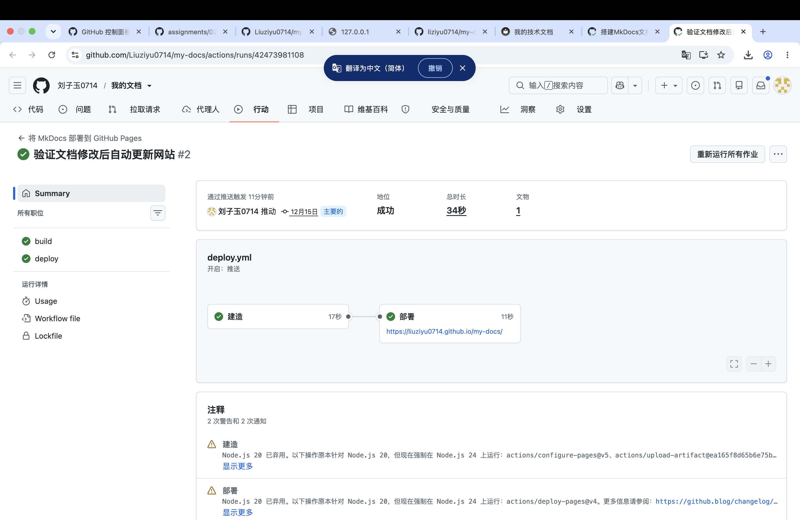
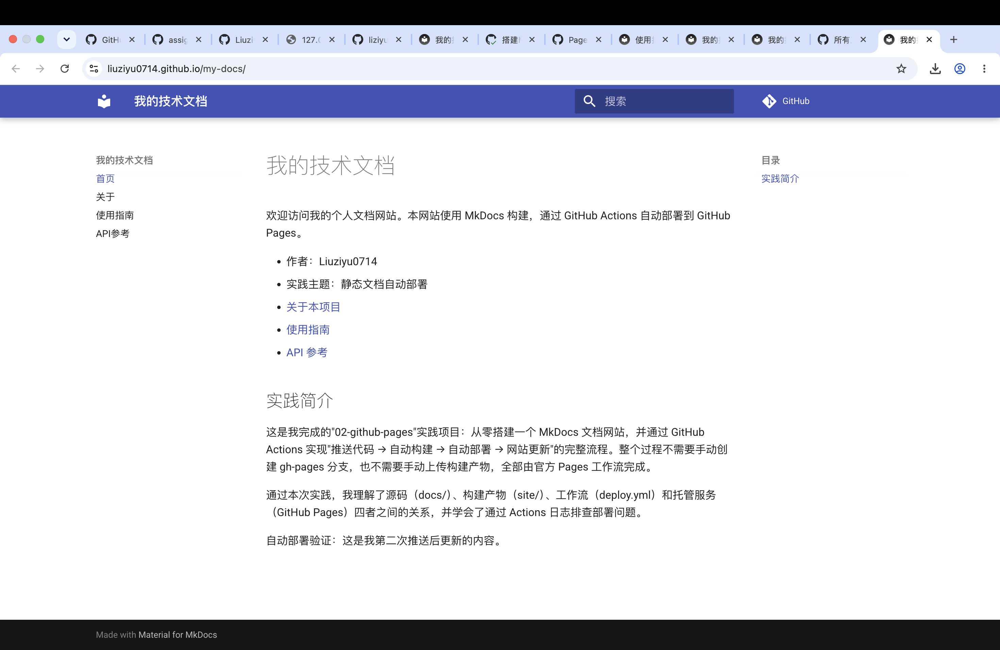

# 实践项目2：个人实验报告

## 1. 基本信息

- GitHub 登录名：Liuziyu0714
- 个人仓库地址：https://github.com/Liuziyu0714/my-docs
- 最终网站地址：https://Liuziyu0714.github.io/my-docs/

## 2. 实践过程与关键截图

### 2.1 仓库创建

（说明：在 GitHub 上新建公开仓库 my-docs，勾选添加 README，默认分支为 main，随后克隆到本地。）

### 2.2 项目结构与 MkDocs 配置

（说明：docs/ 存放四页 Markdown 源码；mkdocs.yml 中的 nav 定义了网站导航，路径相对于 docs/；site/ 是 mkdocs build 生成的静态产物，不手工维护，已加入 .gitignore。）

### 2.3 本地构建或预览

（说明：创建 .venv 虚拟环境，安装 requirements.txt 后执行 `python -m mkdocs build --strict` 构建成功；`python -m mkdocs serve` 后逐个检查了首页、关于、使用指南、API 参考四页的导航、表格和代码块显示。）

### 2.4 Pages 设置

（说明：在 Settings → Pages → Build and deployment 中将 Source 选择为 GitHub Actions；未创建 gh-pages 分支，未修改仓库默认权限。）

### 2.5 Actions 首次构建和部署

（说明：首次推送后，Actions 自动触发 Deploy MkDocs to GitHub Pages，build 任务完成安装、构建并上传 site 制品，deploy 任务在 build 成功后发布到 Pages，两个任务均成功。）

### 2.6 网站访问与四页导航检查

（说明：通过 https://Liuziyu0714.github.io/my-docs/ 访问网站，首页、关于、使用指南、API 参考四页导航均已逐一点开检查，表格、代码块和页面间链接均正常。）

### 2.7 第二次推送与自动更新验证

（说明：修改 docs/index.md 增加"自动部署验证"文字后推送 main，本次 push 自动触发了新的 Actions 运行（未手动重跑），成功后刷新网站即可看到新增内容。）

- 对应提交链接：https://github.com/Liuziyu0714/my-docs/commit/15dece1d99beda1ca83d410b5d8d7d46fb6a1e20
- 对应 Actions 运行链接：https://github.com/Liuziyu0714/my-docs/actions/runs/42473981108

## 3. 问题与解决

**问题：首次 Actions 运行在 Configure Pages 步骤失败。**

- 现象：首次推送后工作流自动触发，build 任务的 Configure Pages 步骤报错，deploy 被跳过。
- 关键日志：`Get Pages site failed. Please verify that the repository has Pages enabled and configured to build using GitHub Actions ... HttpError: Not Found`。
- 原因：推送与工作流触发发生在我到 Settings → Pages 把来源切换为 GitHub Actions 之前，工作流执行时 Pages 尚未启用，configure-pages 拿不到 Pages 站点信息。
- 解决：确认 Pages 来源已设为 GitHub Actions 后，在该次运行页面点击 Re-run failed jobs，build 和 deploy 均成功（首次运行记录：https://github.com/Liuziyu0714/my-docs/actions/runs/42473511426 ）。
- 收获：应先开启 Pages（来源为 GitHub Actions）再触发首次部署；顺序颠倒时重跑失败任务即可，无需修改代码。

## 4. 原理理解

1. **docs/ 和 site/ 各保存什么？为什么不用手工修改 site/？**
   docs/ 保存 Markdown 源码和资源配置（mkdocs.yml 引用的源文件）；site/ 是 `mkdocs build` 生成的静态 HTML 产物。site/ 完全由源码生成，每次构建都会被覆盖重建，手工修改没有意义且会与源码不一致，因此它被加入 .gitignore，由 GitHub Actions 在云端构建后直接作为制品上传部署。

2. **本次工作流在什么情况下自动运行？**
   当推送到 main 分支且改动涉及 `docs/**`、`mkdocs.yml`、`requirements.txt` 或工作流文件本身时自动触发；也可以在 Actions 页面通过 workflow_dispatch 手动运行。

3. **build 与 deploy 两个任务有什么区别？**
   build 负责检出源码、配置 Python、安装依赖、执行 mkdocs build 并把 site/ 上传为 Pages 制品；deploy 依赖 build 成功（needs: build），把制品正式发布到 GitHub Pages，并输出网站地址。两者权限不同：build 只需读取源码，deploy 需要 pages: write 和 id-token: write。

4. **只修改 report/README.md 会触发部署吗？为什么？**
   不会。工作流的 push 触发器用 paths 限定了只有 docs/、mkdocs.yml、requirements.txt 和工作流文件变化才运行，report/ 不在其中，这是预期行为，避免无关改动浪费构建。

5. **本次方案为何无需创建 gh-pages 分支？**
   因为发布来源选择的是 "GitHub Actions"，部署由 actions/deploy-pages 直接把打包好的制品发布到 Pages 托管服务，不依赖任何分支内容；gh-pages 分支是旧的"从分支发布"方案才需要的，两种方案不能混用。
